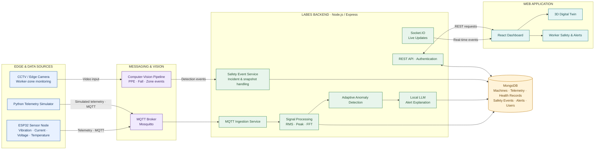

# 🏭 LABES — Live AI-Based Equipment & Worker Safety

> **"Let Machines Speak"** — A unified, intelligent industrial monitoring platform bridging predictive machine maintenance and computer-vision worker safety into a real-time operational dashboard.

[](https://react.dev/)
[](https://nodejs.org/)
[](https://www.mongodb.com/)
[](https://mqtt.org/)
[](https://socket.io/)
[](https://threejs.org/)

---

## 📑 Table of Contents

- [1. Project Overview](#1-project-overview)
- [2. Problem Statement](#2-problem-statement)
- [3. Key Features](#3-key-features)
- [4. Technologies Used](#4-technologies-used)
- [5. Architecture](#5-architecture)
  - [5.1 System Architecture Diagram](#51-system-architecture-diagram)
  - [5.2 Backend Architecture](#52-backend-architecture)
  - [5.3 Frontend Architecture & 3D Digital Twin](#53-frontend-architecture--3d-digital-twin)
  - [5.4 Database Architecture](#54-database-architecture)
- [6. Project Structure](#6-project-structure)
- [7. Installation & Setup](#7-installation--setup)
- [8. Environment Configuration](#8-environment-configuration)
- [Project Acknowledgment](#project-acknowledgment)

---

## 1. Project Overview

**LABES (Live AI-Based Equipment Safety)** is an industrial monitoring platform that brings machine condition monitoring and worker safety supervision together in one application.

The platform combines two complementary capabilities:

- **Machine monitoring:** ESP32 sensor nodes collect vibration, electrical and temperature measurements. The backend processes this telemetry, evaluates machine behavior against an adaptive baseline, and generates alerts to help maintenance teams identify potential anomalies.
- **Worker safety monitoring:** A computer-vision pipeline monitors designated work areas for PPE compliance, falls and zone violations. Detected incidents can be recorded with image snapshots and made available through the dashboard.

A unified web dashboard presents machine data, safety events and alerts, helping teams follow equipment conditions and workplace incidents from one place.

---

## 2. Problem Statement

> _"Industrial environments face two major challenges: Machine failures and worker safety risks. Unexpected changes in machine behavior can lead to downtime, equipment damage, and unsafe situations, while workers may also be exposed to risks when safety rules are not followed._
>
> _Monitoring these issues separately can make it difficult to have a clear picture of what is happening on the shop floor. What is needed is a system that can observe both the machines and the people working around them._
>
> _Our project aims to provide this combined view by bringing together machine health monitoring, anomaly detection, and computer vision for worker safety."_

---

## 3. Key Features

### ⚙️ 1. Predictive Machine Health Monitoring

- **High-Frequency Ingestion**: Real-time telemetry processing (up to 500 Hz) over lightweight MQTT channels.
- **Signal Processing Pipeline**: Computes Root Mean Square (**RMS**), **Peak Acceleration**, Fast Fourier Transform (**FFT**) spectral bins, and frequency domain energy bands.
- **Self-Calibrating Anomaly Detection**: Builds a dynamic baseline from recent operation instead of demanding exhaustive historical failure databases.
- **Configurable Health Score (0–100)**: Transparent categorization into `HEALTHY` (Green), `WARNING` (Yellow), and `CRITICAL` (Red) states.

### 🧠 2. Local LLM Plain-Language Alerting

- Embedded/Local LLM integration ingests vibration and electrical metrics to explain the condition in human language.
- Generates clear, non-cryptic technician summaries (e.g., _"Motor 01 bearing wear detected: 3.2x vibration spike in high-frequency band. Inspect lubrication and alignment."_).

### 🦺 3. Computer Vision Worker Safety

- **PPE Verification**: Identifies workers and verifies helmet and high-visibility vest compliance.
- **Hazard & Fall Detection**: Detects slip-and-fall events and unauthorized zone breaches in real time.
- **Visual Snapshot Audit Trail**: Stores high-resolution image snapshots with bounding boxes alongside each safety incident.

### 🌐 4. Interactive 3D Digital Twin & Live Dashboard

- **React Three Fiber (Three.js)** 3D digital model displaying real-time machine status directly on the shop-floor mesh.
- Live FFT spectrum visualizations, vibration trends, and instant event counters powered by low-latency **Socket.IO** updates.

---

## 4. Technologies Used

```
Frontend:   React 19 • TypeScript • Vite • React Three Fiber • Drei • Three.js • Chart.js
Backend:    Node.js • Express.js 5 • Socket.IO 4 • Mongoose 9 • JWT • Bcrypt • Multer
IoT & Edge: ESP32 Node • MQTT (Eclipse Mosquitto) • Python Telemetry Generator
AI & Vision: FFT Signal Processing • Adaptive Baselines • Local LLM • OpenCV / YOLO
Database:   MongoDB 7 • Mongoose ODM
```

| Domain                    | Technology / Library                     | Purpose                                                           |
| :------------------------ | :--------------------------------------- | :---------------------------------------------------------------- |
| **Frontend Framework**    | React 19, TypeScript, Vite               | Modern, lightning-fast Single Page Application (SPA)              |
| **3D & Visualization**    | Three.js, `@react-three/fiber`, Chart.js | Real-time 3D machine digital twin and interactive spectral graphs |
| **Backend API**           | Node.js, Express.js (v5)                 | Modular RESTful architecture and socket orchestration             |
| **Real-Time Layer**       | Socket.IO                                | Bidirectional push for live machine metrics and safety events     |
| **IoT Protocol**          | MQTT (Eclipse Mosquitto, `mqtt.js`)      | Lightweight telemetry transport from ESP32 edge nodes             |
| **Database**              | MongoDB & Mongoose ODM                   | Time-series telemetry, machine configurations, and safety events  |
| **Authentication**        | JWT (`jsonwebtoken`), `bcryptjs`         | Secure stateless auth with RBAC and password hashing              |
| **Firmware & Simulation** | C++ (Arduino/ESP32), Python 3            | Edge sensor acquisition and synthetic stress-testing scripts      |

---

## 5. Architecture

### 5.1 System Architecture Diagram



### 5.2 Backend Architecture

The backend follows a clean, decoupled service architecture:

- **`config/`**: Database connection initialization (`database.js`) with Mongoose connection pooling and Multer avatar/safety snapshot storage (`upload.js`).
- **`controllers/`**:
  - `auth.js`: Stateless JWT issuance, role selection handling, bcrypt hashing, and profile retrieval.
  - `machinesController.js` & `machineHealthController.js`: Machine threshold CRUD, history filtering, and simulation triggers.
  - `safetyController.js`: Safety incident listing, manual acknowledgments, and resolution updates.
  - `adminController.js` & `usersController.js`: RBAC administration, account approval, and system audits.
- **`services/`**:
  - `mqttService.js`: High-throughput MQTT ingestion, multi-device tracking, and automatic reconnection.
  - `featureExtractionService.js`: Mathematical extraction of RMS, Peak Acceleration, and FFT energy bins from vibration waveforms.
  - `safetyService.js`: Normalization of PPE alerts, fall incidents, and Base64 snapshot persistence in `uploads/safety`.
  - `socketService.js`: Event broadcasting (`telemetry:new`, `safety:event`, `dashboard:updated`).

### 5.3 Frontend Architecture & 3D Digital Twin

Built with **React 19** and **Vite**:

- **Hash-Based Routing**: Zero-flicker transitions across `#dashboard`, `#machines`, `#safety`, `#alerts`, `#users`, and `#settings`.
- **Digital Twin Experience**: Utilizes `@react-three/fiber` and `@react-three/drei` to render 3D industrial motor geometry that dynamically updates its shader glow and warning indicator when threshold violations occur.
- **Reactive State**: Synchronized via custom hooks with `socket.io-client` ensuring zero manual page refreshes.

### 5.4 Database Architecture

All data resides in MongoDB under the database **`let-machines-speak`**:

| Collection             | Key Fields                                                                        | Purpose                                                 |
| :--------------------- | :-------------------------------------------------------------------------------- | :------------------------------------------------------ |
| **`users`**            | `email`, `password`, `role`, `active`, `isApproved`, `workZone`                   | RBAC accounts with bcrypt hashes                        |
| **`machines`**         | `machineId`, `name`, `zone`, `status`, `thresholds`, `lastSeen`                   | Machine registry and configured warning/critical limits |
| **`healthrecords`**    | `machineId`, `timestamp`, `temperature`, `rms`, `peak`, `fftBands`, `healthScore` | Historical calculated health metrics                    |
| **`telemetryrecords`** | `deviceId`, `timestamp`, `vibrationSamples`, `current`, `voltage`                 | High-frequency raw sensor frames                        |
| **`safetyevents`**     | `event`, `zone`, `confidence`, `snapshotUrl`, `status`, `timestamp`               | PPE infractions, falls, and zone breach events          |
| **`alerts`**           | `source`, `machineId`, `severity`, `message`, `acknowledged`                      | Aggregated machine and safety notifications             |
| **`platformsettings`** | `systemName`, `mqttBroker`, `retentionDays`, `updatedAt`                          | Dynamic global system configurations                    |

---

## 6. Project Structure

```text
Let-Machines-Speak/
├── .env                          # Root environment configuration
├── .gitignore                    # Git ignore rules (node_modules, uploads, .env)
├── README.md                     # Project documentation
│
├── backend/                      # Node.js + Express API & IoT Ingestion
│   ├── .env                      # Backend environment file
│   ├── .env.example              # Environment variables template
│   ├── server.js                 # HTTP, Socket.IO & MQTT startup entrypoint
│   ├── package.json              # Backend dependencies and scripts
│   ├── config/
│   │   ├── database.js           # Mongoose MongoDB connection
│   │   └── upload.js             # Multer multipart disk storage
│   ├── controllers/              # REST endpoint handlers
│   │   ├── auth.js               # Sign up, sign in, role management
│   │   ├── machinesController.js # Machine CRUD & simulation
│   │   ├── machineHealthController.js # FFT analysis & metrics
│   │   ├── safetyController.js   # Safety incident tracking
│   │   ├── usersController.js    # User management
│   │   └── dashboardController.js# Aggregated statistics
│   ├── middleware/
│   │   └── authMiddleware.js     # JWT verification & RBAC guard
│   ├── models/                   # Mongoose schemas
│   │   ├── user.js               # User accounts & roles
│   │   ├── machine.js            # Industrial machines & thresholds
│   │   ├── HealthRecord.js       # Health scores & FFT features
│   │   ├── TelemetryRecord.js    # Raw IoT telemetry frames
│   │   ├── SafetyEvent.js        # CV worker safety detections
│   │   └── alert.js              # Active & historic alerts
│   ├── routes/                   # Express route routers
│   ├── services/                 # Core background services
│   │   ├── mqttService.js        # MQTT subscriber & packet parser
│   │   ├── featureExtractionService.js # RMS & FFT signal extraction
│   │   ├── safetyService.js      # Vision safety snapshot handling
│   │   └── socketService.js      # Socket.IO broadcasting
│   ├── scripts/
│   │   ├── seed.js               # Database seeder (admin & sample machines)
│   │   └── migrateUsersApproval.js# User migration script
│   ├── Iot/
│   │   └── mock_esp32_telemetry.py # High-speed Python IoT simulator
│   └── tests/                    # Automated Node.js unit & integration tests
│
└── Frontend/                     # React 19 + TypeScript + Vite Dashboard
    ├── index.html                # Vite HTML shell
    ├── package.json              # Frontend dependencies
    ├── vite.config.ts            # Vite compiler configuration
    └── src/
        ├── App.tsx               # Root application router & socket sync
        ├── main.tsx              # React DOM entry point
        ├── components/           # Reusable UI components & 3D canvas
        │   ├── Layout.tsx        # Responsive navigation & sidebar
        │   └── LabesLogo.tsx     # Branding SVG
        ├── pages/
        │   ├── Dashboard.tsx     # Unified operational overview
        │   ├── MachineHealth.tsx # Detailed vibration, FFT & machine analytics
        │   ├── worker-safety/    # Safety monitoring & snapshot viewer
        │   ├── AlertsPage.tsx    # Live alert feed & resolution
        │   ├── auth/             # Login, signup (with role selection), change-password
        │   └── admin/            # Machine & user administrative consoles
        ├── services/             # Axios/Fetch API clients & WebSocket connectors
        └── types/                # TypeScript interfaces (Machine, SafetyEvent, User)
```

---

## 7. Installation & Setup

### Prerequisites

Ensure the following are installed on your workstation:

- **Node.js**: v18.0.0 or higher
- **MongoDB**: v6.0 or higher (running locally or via Docker)
- **MQTT Broker**: Eclipse Mosquitto (or public test broker `mqtt://test.mosquitto.org:1883`)
- **Python 3** _(optional, for synthetic IoT device simulation)_

---

### Step 1: Start Database & MQTT via Docker (Recommended)

If you have Docker installed, start MongoDB and Mosquitto with a single command:

```powershell
# Start MongoDB Container on port 27017
docker run -d --name mongodb -p 27017:27017 -v mongo_data:/data/db mongo:latest
```

---

### Step 2: Configure and Start the Backend

1. Navigate to the backend directory:

   ```powershell
   cd backend
   ```

2. Install dependencies:

   ```powershell
   npm install
   ```

3. Configure environment variables (verify [`backend/.env`](backend/.env)):

   ```env
   PORT=5000
   MONGO_URI=mongodb://127.0.0.1:27017/let-machines-speak
   JWT_SECRET=your_super_secret_jwt_key_here
   MQTT_BROKER_URL=mqtt://127.0.0.1:1883
   ```

4. Seed the database with sample machines and initial administrator:

   ```powershell
   npm run seed
   ```

5. Start the backend in development mode:
   ```powershell
   npm run dev
   ```
   _The API will listen at `http://127.0.0.1:5000`._

---

### Step 3: Configure and Start the Frontend

1. In a new terminal, navigate to the `Frontend` directory:

   ```powershell
   cd Frontend
   ```

2. Install dependencies:

   ```powershell
   npm install
   ```

3. Launch the Vite development server:

   ```powershell
   npm run dev
   ```

4. Open your browser and navigate to:
   ```text
   http://localhost:5173
   ```

---

### Step 4: Run the IoT Telemetry Simulator (Optional)

To simulate live ESP32 sensor streams emitting continuous vibration and current data:

```powershell
cd backend/Iot
python mock_esp32_telemetry.py --broker 127.0.0.1 --port 1883 --device node01
```

---

## 8. Environment Configuration

### Backend Configuration (`backend/.env`)

| Variable                  | Default Value                                  | Description                                         |
| :------------------------ | :--------------------------------------------- | :-------------------------------------------------- |
| `PORT`                    | `5000`                                         | Port for the Express server to listen on            |
| `MONGO_URI`               | `mongodb://127.0.0.1:27017/let-machines-speak` | MongoDB connection URI                              |
| `JWT_SECRET`              | `your_super_secret_jwt_key_here`               | Secret key used for signing JWT auth tokens         |
| `JWT_EXPIRES_IN`          | `1d`                                           | Lifetime of issued JWT tokens                       |
| `SEED_ADMIN_NAME`         | `LABES Admin`                                  | Display name of seeded root admin                   |
| `SEED_ADMIN_EMAIL`        | `admin@labes.local`                            | Email of seeded root admin                          |
| `SEED_ADMIN_PASSWORD`     | `Admin123!`                                    | Initial password for seeded root admin              |
| `MQTT_BROKER_URL`         | `mqtt://127.0.0.1:1883`                        | Host URL of MQTT broker                             |
| `MQTT_TELEMETRY_TOPIC`    | `devices/+/telemetry`                          | Wildcard topic for ESP32 sensor frames              |
| `MQTT_SAFETY_ALERT_TOPIC` | `safety/alerts`                                | Topic for computer vision safety alerts             |
| `MQTT_OFFLINE_TIMEOUT_MS` | `10000`                                        | Milliseconds before a silent node is marked OFFLINE |

### Frontend Configuration (`Frontend/.env`)

| Variable            | Default Value           | Description                                    |
| :------------------ | :---------------------- | :--------------------------------------------- |
| `VITE_API_BASE_URL` | `http://127.0.0.1:5000` | Base URL of the backend REST and Socket.IO API |

---

## Project Acknowledgment

Developed as part of the **IEEE IAS/IES/PES ESPRIT SBJC Chapter** project.
